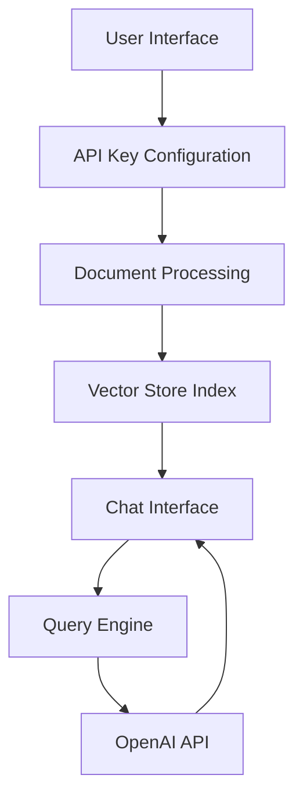

# Talk to PDF 🤖📑

[](https://talk-to-pdf.streamlit.app/)
[](https://www.python.org/downloads/)
[](https://choosealicense.com/licenses/mit/)
[](https://openai.com/blog/openai-api)

An innovative AI-powered application that enables natural language interaction with PDF documents. Ask questions about your PDFs and get instant, context-aware responses powered by OpenAI's language models and LlamaIndex document processing.

## Table of Contents
- [Quick Start](#quick-start)
- [Features](#features)
- [Technical Architecture](#technical-architecture)
- [Installation](#installation)
- [Usage Guide](#usage-guide)
- [Implementation Details](#implementation-details)
- [Technology Stack](#technology-stack)
- [Contributing](#contributing)
- [License](#license)
- [Contact](#contact)

## Quick Start

1. Clone the repository
```bash
git clone https://github.com/yourusername/talk-to-pdf.git
cd talk-to-pdf
```

2. Install dependencies
```bash
pip install -r requirements.txt
```

3. Run the application
```bash
streamlit run 0_🔌API_KEY.py
```

## Features

### 🔑 Secure API Integration
- Streamlined OpenAI API key configuration
- Secure credential management
- Session-based state persistence

### 📄 Advanced Document Processing
- Multi-PDF file support
- Intelligent document indexing
- Vector-based content storage
- Efficient retrieval system

### 💬 Interactive Chat Interface
- Natural language querying
- Context-aware responses
- Real-time response streaming
- Conversation history management

### ⚙️ Customization Options
- Multiple GPT model selection
- Adjustable response parameters
- Flexible processing settings

## Technical Architecture

The application follows a three-tier architecture:



### Core Components

1. **API Configuration Module** (`0_🔌API_KEY.py`)
   - Handles API key validation
   - Manages authentication state
   - Controls access flow

2. **Document Processing Engine** (`pages/1_📑UPLOAD_PDF.py`)
   - PDF upload handling
   - Document indexing
   - Vector store creation

3. **Chat Interface System** (`pages/2_💬CHAT_WITH_PDF.py`)
   - Interactive query interface
   - Context management
   - Response streaming

## Installation

### Prerequisites
- Python 3.11 or higher
- OpenAI API key
- Internet connection

### Dependencies
```txt
streamlit==1.38.0
openai==1.43.0
llama-index==0.11.3
pypdf==4.3.1
```

### Setup Instructions
1. Create a virtual environment
```bash
python -m venv venv
source venv/bin/activate  # Linux/Mac
venv\Scripts\activate     # Windows
```

2. Install requirements
```bash
pip install -r requirements.txt
```

3. Configure environment
```bash
cp .env.example .env
# Edit .env with your OpenAI API key
```

## Usage Guide

1. **API Key Configuration**
   - Launch the application
   - Enter your OpenAI API key
   - Verify successful configuration

2. **Document Upload**
   - Select PDF file(s)
   - Wait for processing completion
   - Confirm successful indexing

3. **Querying Documents**
   - Enter natural language questions
   - Review context-aware responses
   - Engage in follow-up queries

## Implementation Details

### Document Processing Pipeline
```python
def load_document(uploaded_files):
    temp_dir = tempfile.TemporaryDirectory()
    for file in uploaded_files:
        temp_filepath = os.path.join(temp_dir.name, file.name)
        with open(temp_filepath, "wb") as f:
            f.write(file.getvalue())
    reader = SimpleDirectoryReader(input_dir=temp_dir.name)
    return reader.load_data()
```

### Query Engine Configuration
```python
def query_engine(docs, model_name, temperature):    
    llm = OpenAI(model=model_name, temperature=temperature)
    Settings.llm = llm
    index = VectorStoreIndex.from_documents(docs, llm=llm)
    return index.as_query_engine()
```

### Chat Interface Implementation
```python
custom_prompt = PromptTemplate("""
Given a conversation (between Human and Assistant) and a follow up message from Human, 
rewrite the message to be a standalone question that captures all relevant context 
from the conversation.

<Chat History> 
{chat_history}

<Follow Up Message>
{question}

<Standalone question>
""")
```

## Technology Stack

### Core Technologies
- **Python 3.11**: Primary development language
- **Streamlit 1.38.0**: Web application framework
- **OpenAI API 1.43.0**: Natural language processing
- **LlamaIndex 0.11.3**: Document processing and indexing

### UI Components
- streamlit-chat: Chat interface components
- streamlit-extras: Additional UI utilities
- markdownlit: Enhanced markdown rendering

### Document Processing
- PyPDF: PDF file handling
- LlamaIndex: Vector store and indexing
- SimpleDirectoryReader: Document reading

## Contributing

1. Fork the repository
2. Create a feature branch
```bash
git checkout -b feature/amazing-feature
```
3. Commit changes
```bash
git commit -m 'Add amazing feature'
```
4. Push to branch
```bash
git push origin feature/amazing-feature
```
5. Open a Pull Request

## License

This project is licensed under the MIT License - see the [LICENSE](LICENSE) file for details.

## Contact

**Author**: [Kaushal](https://www.linkedin.com/in/kaushal-powar-a52b1a159/)  
**Twitter**: [@holy_kau](https://twitter.com/holy_kau)  
**Project Link**: [https://github.com/yourusername/talk-to-pdf](https://github.com/yourusername/talk-to-pdf)

---

Made with ❤️ by Kaushal | Enjoy interacting with your PDFs using natural language! 🚀📄