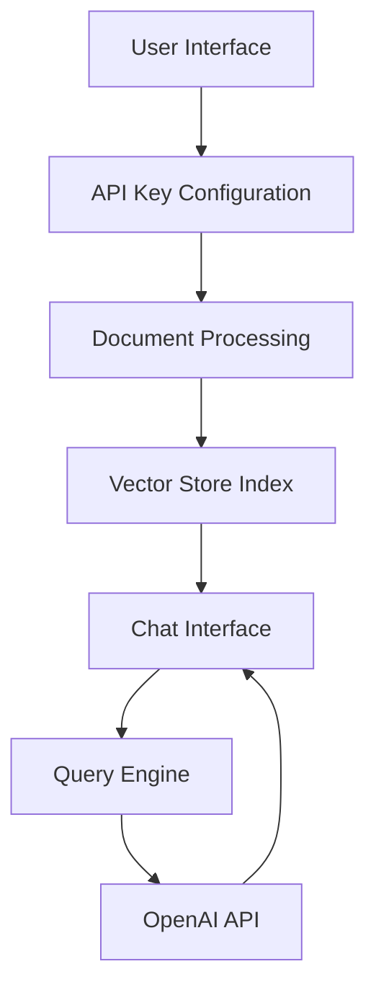

# Talk to PDF 🤖 📑

[](https://talk-to-pdf.streamlit.app/)
[](https://www.python.org/downloads/)
[](https://choosealicense.com/licenses/mit/)

## 📋 Table of Contents

- [Overview](#overview)
- [Features](#features)
- [Architecture](#architecture)
- [Installation](#installation)
- [Usage](#usage)
- [Technical Details](#technical-details)
- [Contributing](#contributing)
- [License](#license)
- [Contact](#contact)

## 🔍 Overview

Talk to PDF is an innovative web application that enables natural language interaction with PDF documents through an AI-powered interface. The application leverages OpenAI's language models and LlamaIndex for document processing to create a seamless question-answering system for PDF content.

### Key Components

1. API Configuration Interface
2. Document Upload and Processing System
3. Interactive Chat Interface

## ✨ Features

### 1. Intelligent PDF Processing
- Advanced document indexing using LlamaIndex
- Efficient vector storage implementation
- Secure document handling
- Multiple PDF file support

### 2. Context-Aware Question Answering
- Natural language understanding
- Conversation context maintenance
- Accurate response generation
- Custom prompt templates

### 3. Real-Time Response Streaming
- Immediate feedback system
- Progressive response generation
- Efficient token handling
- Smooth user experience

### 4. Customizable Experience
- Multiple language model options (GPT-3.5, GPT-4)
- Adjustable response parameters
- Temperature control for output variation
- Flexible conversation settings

## 🏗 Architecture

### System Components



### Technology Stack

#### Core Technologies
- **Python 3.11**: Primary development language
- **Streamlit 1.38.0**: Web application framework
- **OpenAI API 1.43.0**: Language processing engine
- **LlamaIndex 0.11.3**: Document processing system

#### Key Dependencies
- **streamlit-chat**: Chat interface components
- **streamlit-extras**: UI utilities
- **PyPDF**: PDF processing
- **Vector storage**: Document indexing

## 📥 Installation

1. Clone the repository:
```bash
git clone https://github.com/yourusername/talk-to-pdf.git
cd talk-to-pdf
```

2. Install dependencies:
```bash
pip install -r requirements.txt
```

3. Set up environment:
```bash
cp .env.example .env
# Add your OpenAI API key to .env file
```

## 🚀 Usage

1. Start the application:
```bash
streamlit run 0_🔌API_KEY.py
```

2. Enter your OpenAI API key
3. Upload PDF document(s)
4. Start asking questions about your documents

## 🔧 Technical Details

### Document Processing Pipeline

```python
def load_document(uploaded_files):
    temp_dir = tempfile.TemporaryDirectory()
    for file in uploaded_files:
        temp_filepath = os.path.join(temp_dir.name, file.name)
        with open(temp_filepath, "wb") as f:
            f.write(file.getvalue())
    reader = SimpleDirectoryReader(input_dir=temp_dir.name)
    docs = reader.load_data()
    return docs
```

### Chat Engine Implementation

```python
custom_prompt = PromptTemplate("""
Given a conversation (between Human and Assistant) and a follow up message from Human, \
rewrite the message to be a standalone question that captures all relevant context \
from the conversation.

<Chat History> 
{chat_history}

<Follow Up Message>
{question}

<Standalone question>
""")

chat_engine = CondenseQuestionChatEngine.from_defaults(
    query_engine=query_engine, 
    condense_question_prompt=custom_prompt,
    chat_history=custom_chat_history
)
```

### State Management

```python
if 'history' not in st.session_state:
    st.session_state['history'] = []
if 'generated' not in st.session_state:
    st.session_state['generated'] = ["Hello! Ask me anything about the uploaded document 🤗"]
if 'past' not in st.session_state:
    st.session_state['past'] = ["Hey! 👋"]
```

## 🤝 Contributing

1. Fork the repository
2. Create your feature branch (`git checkout -b feature/AmazingFeature`)
3. Commit your changes (`git commit -m 'Add some AmazingFeature'`)
4. Push to the branch (`git push origin feature/AmazingFeature`)
5. Open a Pull Request

## 📄 License

This project is licensed under the MIT License - see the [LICENSE](LICENSE) file for details.

## 📬 Contact

Author: [Kaushal](https://www.linkedin.com/in/kaushal-powar-a52b1a159/)

Project Link: [https://github.com/yourusername/talk-to-pdf](https://github.com/yourusername/talk-to-pdf)

---

Built with ❤️ by Kaushal | [Twitter](https://twitter.com/holy_kau)