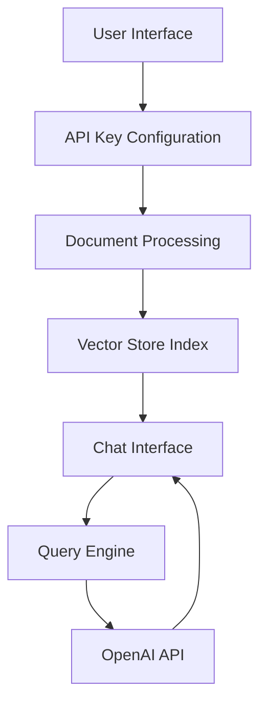

# Talk to PDF 🤖📑

[](https://talk-to-pdf.streamlit.app/)
[](https://www.python.org/downloads/)
[](https://platform.openai.com/)
[](https://opensource.org/licenses/MIT)

> An AI-powered application that enables natural language interaction with PDF documents through an intuitive chat interface.

## 🚀 Quick Start

1. Clone the repository
2. Install dependencies: `pip install -r requirements.txt`
3. Get your OpenAI API key from [platform.openai.com](https://platform.openai.com/account/api-keys)
4. Run the app: `streamlit run 0_🔌API_KEY.py`

## 🎯 Features

- 📄 Intelligent PDF processing and indexing
- 💬 Natural language question-answering
- 🔄 Context-aware conversation handling
- ⚡ Real-time response streaming
- 🎛️ Configurable AI model parameters
- 🔒 Secure API key management

## 🏗️ Architecture

The application follows a modern three-tier architecture:



### Core Components

1. **API Configuration Interface**
   - Secure API key management
   - Session state persistence
   - Validation and error handling

2. **Document Processing System**
   - PDF upload and validation
   - Content extraction and indexing
   - Vector store creation

3. **Interactive Chat Interface**
   - Context-aware conversations
   - Real-time response streaming
   - History management

## 💻 Technical Stack

### Core Technologies
- **Python** (3.11): Primary development language
- **Streamlit** (1.38.0): Web application framework
- **OpenAI** (1.43.0): Language model integration
- **LlamaIndex** (0.11.3): Document processing and indexing

### Key Dependencies
```txt
streamlit==1.38.0
openai==1.43.0
llama-index==0.11.3
pypdf==4.3.1
streamlit-chat==0.1.1
streamlit-extras==0.4.7
```

## 📖 Usage Guide

### 1. API Key Configuration
```python
# Enter your OpenAI API key securely
api_key = st.text_input("Enter your OpenAI API key", type="password")
```

### 2. Document Processing
```python
# Upload and process PDF documents
def load_document(uploaded_files):
    temp_dir = tempfile.TemporaryDirectory()
    reader = SimpleDirectoryReader(input_dir=temp_dir.name)
    docs = reader.load_data()
    return docs
```

### 3. Chat Interface
```python
# Context-aware conversation handling
custom_prompt = PromptTemplate("""
    Given a conversation and follow-up message, 
    rewrite as a standalone question with context.
    {chat_history}
    {question}
""")
```

## 🔧 Development

### Project Structure
```
talk_to_pdf/
├── 0_🔌API_KEY.py          # Entry point
├── functions.py            # Shared utilities
└── pages/
    ├── 1_📑UPLOAD_PDF.py   # Document processing
    └── 2_💬CHAT_WITH_PDF.py # Chat interface
```

### State Management
```python
# Session state initialization
if 'history' not in st.session_state:
    st.session_state['history'] = []
if 'generated' not in st.session_state:
    st.session_state['generated'] = ["Hello! 🤗"]
```

## 🌟 Benefits

1. **Enhanced Efficiency**
   - Quick information extraction
   - Natural language queries
   - Context-aware responses

2. **User Experience**
   - Intuitive interface
   - Real-time feedback
   - Customizable settings

3. **Technical Advantages**
   - Scalable architecture
   - Efficient memory management
   - Secure document handling

## 🤝 Contributing

1. Fork the repository
2. Create your feature branch: `git checkout -b feature/AmazingFeature`
3. Commit your changes: `git commit -m 'Add AmazingFeature'`
4. Push to the branch: `git push origin feature/AmazingFeature`
5. Open a Pull Request

## 📝 License

This project is licensed under the MIT License - see the [LICENSE](LICENSE) file for details.

## 📬 Contact

Kaushal - [@holy_kau](https://twitter.com/holy_kau)

Project Link: [https://github.com/yourusername/talk-to-pdf](https://github.com/yourusername/talk-to-pdf)

---

Made with ❤️ by [Kaushal](https://www.linkedin.com/in/kaushal-powar-a52b1a159/)