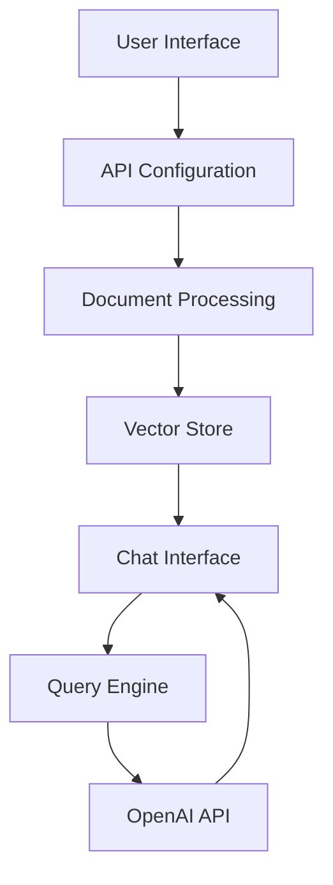

# Talk to PDF 🤖📑

[](https://talk-to-pdf.streamlit.app/)
[](https://www.python.org/downloads/)
[](https://openai.com/api/)
[](https://opensource.org/licenses/MIT)

> An AI-powered application for natural language interaction with PDF documents

## 📑 Table of Contents

- [Overview](#overview)
- [Features](#features)
- [Architecture](#architecture)
- [Installation](#installation)
- [Usage](#usage)
- [Technical Details](#technical-details)
- [Contributing](#contributing)
- [License](#license)
- [Contact](#contact)

## 🔍 Overview

Talk to PDF is an innovative web application that enables natural language interaction with PDF documents through an AI-powered interface. Built with OpenAI's language models and LlamaIndex for document processing, it provides a seamless question-answering system for PDF content.

### Key Components

1. API Configuration Interface
2. Document Upload and Processing System
3. Interactive Chat Interface

## ✨ Features

### 1. Intelligent PDF Processing
- Advanced document indexing using LlamaIndex
- Efficient vector storage for quick retrieval
- Support for multiple PDF documents
- Secure document handling

### 2. Context-Aware Chat Interface
- Natural language question answering
- Conversation history management
- Real-time response streaming
- Custom prompt templates

### 3. Flexible Configuration
- Choice between GPT-3.5 and GPT-4 models
- Adjustable response parameters
- Customizable temperature settings
- Multiple document support

## 🏗 Architecture

The application follows a three-tier architecture:



### Technology Stack

- **Frontend**: Streamlit (v1.38.0)
- **AI/ML**: OpenAI API (v1.43.0)
- **Document Processing**: LlamaIndex (v0.11.3)
- **PDF Handling**: PyPDF (v4.3.1)

## 🚀 Installation

1. Clone the repository:
```bash
git clone https://github.com/yourusername/talk-to-pdf.git
cd talk-to-pdf
```

2. Install dependencies:
```bash
pip install -r requirements.txt
```

3. Set up your OpenAI API key:
```bash
export OPENAI_API_KEY='your-api-key'
```

## 💻 Usage

1. Start the application:
```bash
streamlit run 0_🔌API_KEY.py
```

2. Enter your OpenAI API key in the interface

3. Upload your PDF document(s)

4. Start chatting with your documents!

## 🔧 Technical Details

### Document Processing Pipeline

```python
def load_document(uploaded_files):
    temp_dir = tempfile.TemporaryDirectory()
    for file in uploaded_files:
        temp_filepath = os.path.join(temp_dir.name, file.name)
        with open(temp_filepath, "wb") as f:
            f.write(file.getvalue())
    reader = SimpleDirectoryReader(input_dir=temp_dir.name)
    return reader.load_data()
```

### Chat Engine Configuration

```python
chat_engine = CondenseQuestionChatEngine.from_defaults(
    query_engine=query_engine, 
    condense_question_prompt=custom_prompt,
    chat_history=custom_chat_history
)
```

### Response Streaming

```python
def conversational_chat(query):
    streaming_response = chat_engine.stream_chat(query)
    return ''.join(token for token in streaming_response.response_gen)
```

## 🤝 Contributing

Contributions are welcome! Please follow these steps:

1. Fork the repository
2. Create a feature branch (`git checkout -b feature/AmazingFeature`)
3. Commit your changes (`git commit -m 'Add some AmazingFeature'`)
4. Push to the branch (`git push origin feature/AmazingFeature`)
5. Open a Pull Request

### Development Setup

1. Set up a virtual environment:
```bash
python -m venv venv
source venv/bin/activate  # Unix
.\venv\Scripts\activate   # Windows
```

2. Install development dependencies:
```bash
pip install -r requirements-dev.txt
```

## 📄 License

This project is licensed under the MIT License - see the [LICENSE](LICENSE) file for details.

## 📬 Contact

Author: [Kaushal](https://twitter.com/holy_kau)

Project Link: [https://github.com/yourusername/talk-to-pdf](https://github.com/yourusername/talk-to-pdf)

---

<div align="center">

Made with ❤️ by Kaushal | [Support my work](https://www.buymeacoffee.com/kaushal.ai)

</div>