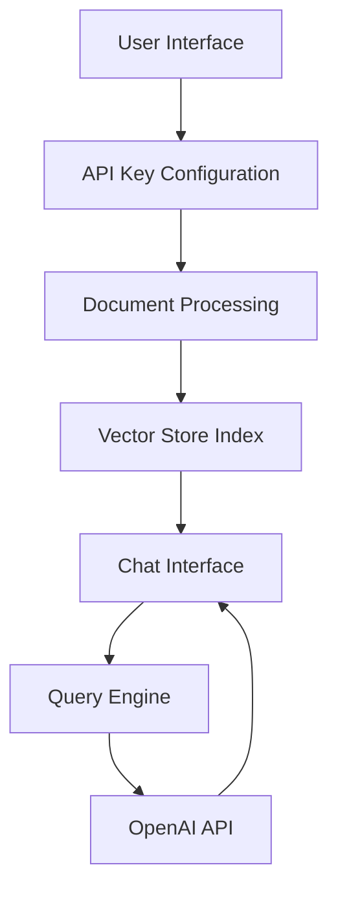

# Talk to PDF 🤖📑

[](https://talk-to-pdf.streamlit.app/)
[](https://www.python.org/downloads/)
[](https://opensource.org/licenses/MIT)

> An AI-powered application that enables natural language interaction with PDF documents through an intuitive chat interface.

## Table of Contents
- [Overview](#overview)
- [Features](#features)
- [Prerequisites](#prerequisites)
- [Quick Start](#quick-start)
- [Architecture](#architecture)
- [Technical Implementation](#technical-implementation)
- [Benefits](#benefits)
- [Development](#development)
- [License](#license)
- [Contact](#contact)

## Overview

Talk to PDF is a modern web application that transforms how users interact with PDF documents. By leveraging OpenAI's language models and LlamaIndex for document processing, it creates a seamless question-answering system that allows users to extract information through natural conversation rather than manual searching.

### Core Components
1. API Configuration Interface
2. Document Upload and Processing System
3. Interactive Chat Interface

## Features

- 🔍 **Intelligent PDF Processing**
  - Advanced document indexing
  - Vector-based content storage
  - Efficient retrieval system

- 💬 **Context-Aware Chat**
  - Natural language interaction
  - Conversation history tracking
  - Contextual response generation

- ⚡ **Real-Time Processing**
  - Streaming responses
  - Progressive document loading
  - Instant feedback

- 🎛️ **Customization Options**
  - Multiple language models (GPT-3.5, GPT-4)
  - Adjustable response parameters
  - Temperature control for outputs

## Prerequisites

- Python 3.11 or higher
- OpenAI API key
- Internet connection
- Modern web browser

## Quick Start

1. **Install Dependencies**
```bash
pip install -r requirements.txt
```

2. **Configure API Key**
- Launch the application
- Enter your OpenAI API key when prompted
- Verify successful configuration

3. **Upload Document**
- Select PDF file(s) for processing
- Wait for indexing completion
- Confirm successful upload

4. **Start Chatting**
- Enter questions about your document
- Receive AI-powered responses
- Engage in natural conversation

## Architecture

### System Components



### Technology Stack

- **Frontend**: Streamlit 1.38.0
- **AI/ML**: OpenAI API 1.43.0
- **Document Processing**: LlamaIndex 0.11.3
- **PDF Handling**: PyPDF 4.3.1

## Technical Implementation

### Document Processing Pipeline

```python
def load_document(uploaded_files):
    temp_dir = tempfile.TemporaryDirectory()
    for file in uploaded_files:
        temp_filepath = os.path.join(temp_dir.name, file.name)
        with open(temp_filepath, "wb") as f:
            f.write(file.getvalue())
    reader = SimpleDirectoryReader(input_dir=temp_dir.name)
    return reader.load_data()
```

### Chat Engine Configuration

```python
chat_engine = CondenseQuestionChatEngine.from_defaults(
    query_engine=query_engine, 
    condense_question_prompt=custom_prompt,
    chat_history=custom_chat_history
)
```

### Response Streaming

```python
def conversational_chat(query):
    streaming_response = chat_engine.stream_chat(query)
    return ''.join(token for token in streaming_response.response_gen)
```

## Benefits

### Enhanced Efficiency
- Instant document content access
- Natural language querying
- Context-aware responses

### User Experience
- Intuitive chat interface
- Real-time feedback
- Customizable responses

### Technical Advantages
- Scalable architecture
- Efficient memory management
- Secure document processing
- Modular design

## Development

### Project Structure
```
talk_to_pdf/
├── 0_🔌API_KEY.py          # API configuration
├── functions.py            # Utility functions
└── pages/
    ├── 1_📑UPLOAD_PDF.py   # Document processing
    └── 2_💬CHAT_WITH_PDF.py # Chat interface
```

### Contributing
1. Fork the repository
2. Create your feature branch (`git checkout -b feature/AmazingFeature`)
3. Commit your changes (`git commit -m 'Add some AmazingFeature'`)
4. Push to the branch (`git push origin feature/AmazingFeature`)
5. Open a Pull Request

## License

This project is licensed under the MIT License - see the [LICENSE](LICENSE) file for details.

## Contact

Author: [Kaushal](https://twitter.com/holy_kau)

Project Link: [https://github.com/yourusername/talk-to-pdf](https://github.com/yourusername/talk-to-pdf)

---

Made with ❤️ by Kaushal | [Support my work](https://www.buymeacoffee.com/kaushal.ai)