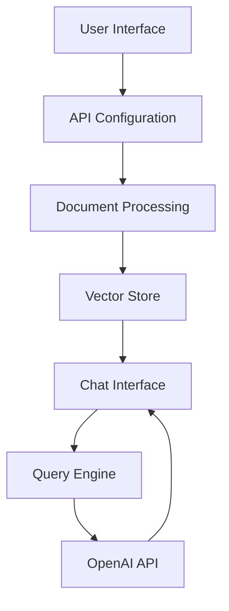

# Talk to PDF 🤖📑

[](https://talk-to-pdf.streamlit.app/)
[](https://www.python.org/downloads/release/python-311/)
[](https://opensource.org/licenses/MIT)

> An AI-powered application that enables natural language interaction with PDF documents through an intuitive chat interface.

## 📑 Table of Contents

- [Overview](#overview)
- [Features](#features)
- [Technology Stack](#technology-stack)
- [Getting Started](#getting-started)
- [Architecture](#architecture)
- [Technical Documentation](#technical-documentation)
- [Contributing](#contributing)
- [License](#license)
- [Contact](#contact)

## 🔍 Overview

Talk to PDF transforms how users interact with PDF documents by leveraging cutting-edge AI technology. Built on OpenAI's language models and LlamaIndex for document processing, the application enables users to extract information through natural conversation rather than manual searching.

### Key Benefits

- **Instant Information Access**: Query document content using natural language
- **Context-Aware Responses**: Get accurate answers that consider the full document context
- **User-Friendly Interface**: Intuitive chat-based interaction with clear visual feedback
- **Flexible Configuration**: Customize AI model parameters for different use cases

## ✨ Features

### 1. Intelligent PDF Processing
- Multiple PDF file support
- Automatic document indexing
- Efficient vector-based search
- Secure document handling

### 2. Context-Aware Chat Interface
- Natural language interaction
- Conversation history tracking
- Real-time response streaming
- Custom prompt templates

### 3. Flexible Model Selection
- Support for GPT-3.5 and GPT-4
- Adjustable temperature settings
- Customizable response parameters

## 🛠 Technology Stack

### Core Technologies
- **Python** (3.11)
- **Streamlit** (1.38.0)
- **OpenAI API** (1.43.0)
- **LlamaIndex** (0.11.3)
- **PyPDF** (4.3.1)

### UI Components
- streamlit-chat (0.1.1)
- streamlit-extras (0.4.7)
- Additional UI utilities

## 🚀 Getting Started

### Prerequisites
- Python 3.11 or higher
- OpenAI API key
- pip package manager

### Installation

1. Clone the repository:
```bash
git clone https://github.com/yourusername/talk-to-pdf.git
cd talk-to-pdf
```

2. Install dependencies:
```bash
pip install -r requirements.txt
```

3. Run the application:
```bash
streamlit run 0_🔌API_KEY.py
```

### Usage

1. **Enter OpenAI API Key**
   - Launch the application
   - Input your OpenAI API key
   - Click Submit

2. **Upload PDF**
   - Select PDF file(s)
   - Wait for processing
   - Proceed to chat interface

3. **Start Chatting**
   - Ask questions about the document
   - Receive AI-powered responses
   - View conversation history

## 🏗 Architecture

### System Components

1. **API Configuration Module** (`0_🔌API_KEY.py`)
   - Secure API key management
   - Session state initialization
   - Configuration validation

2. **Document Processing Engine** (`pages/1_📑UPLOAD_PDF.py`)
   - PDF upload handling
   - Document indexing
   - Vector store creation

3. **Chat Interface System** (`pages/2_💬CHAT_WITH_PDF.py`)
   - Conversation management
   - Context-aware responses
   - Real-time streaming

### Data Flow



## 📚 Technical Documentation

### Vector Store Implementation
```python
def load_document(uploaded_files):
    temp_dir = tempfile.TemporaryDirectory()
    for file in uploaded_files:
        temp_filepath = os.path.join(temp_dir.name, file.name)
        with open(temp_filepath, "wb") as f:
            f.write(file.getvalue())
    reader = SimpleDirectoryReader(input_dir=temp_dir.name)
    docs = reader.load_data()
    return docs
```

### Chat Engine Configuration
```python
chat_engine = CondenseQuestionChatEngine.from_defaults(
    query_engine=query_engine, 
    condense_question_prompt=custom_prompt,
    chat_history=custom_chat_history
)
```

### State Management
```python
if 'history' not in st.session_state:
    st.session_state['history'] = []
if 'generated' not in st.session_state:
    st.session_state['generated'] = ["Hello! Ask me anything about the uploaded document 🤗"]
if 'past' not in st.session_state:
    st.session_state['past'] = ["Hey! 👋"]
```

## 🤝 Contributing

Contributions are welcome! Please follow these steps:

1. Fork the repository
2. Create a feature branch (`git checkout -b feature/AmazingFeature`)
3. Commit your changes (`git commit -m 'Add some AmazingFeature'`)
4. Push to the branch (`git push origin feature/AmazingFeature`)
5. Open a Pull Request

## 📄 License

This project is licensed under the MIT License - see the [LICENSE](LICENSE) file for details.

## 📬 Contact

**Author**: [Kaushal](https://www.linkedin.com/in/kaushal-powar-a52b1a159/)

**Twitter**: [@holy_kau](https://twitter.com/holy_kau)

**Project Link**: [https://github.com/yourusername/talk-to-pdf](https://github.com/yourusername/talk-to-pdf)

---

Made with ❤️ by Kaushal | Enjoy interacting with your PDFs using natural language! 🚀📄