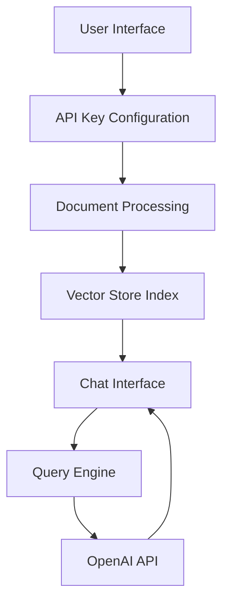

# Talk to PDF 🤖📑

[](https://talk-to-pdf.streamlit.app/)
[](https://www.python.org/downloads/)
[](https://choosealicense.com/licenses/mit/)
[](https://openai.com/api/)

An innovative AI-powered application that enables natural language interaction with PDF documents. Ask questions about your PDFs and get instant, context-aware responses powered by OpenAI's language models and LlamaIndex document processing.

## 🚀 Features

- **Natural Language Queries**: Ask questions about your PDFs in plain English
- **Context-Aware Responses**: Get accurate answers that consider the full context of your documents
- **Multiple PDF Support**: Upload and analyze multiple PDF files simultaneously
- **Real-Time Processing**: Stream responses as they're generated for better user experience
- **Customizable AI Models**: Choose between GPT-3.5 and GPT-4 with adjustable parameters
- **Secure Processing**: Local document handling with secure API integration

## 📋 Prerequisites

- Python 3.11 or higher
- OpenAI API key ([Get one here](https://platform.openai.com/account/api-keys))
- Internet connection for API access

## 🛠️ Installation

1. Clone the repository:
```bash
git clone https://github.com/yourusername/talk-to-pdf.git
cd talk-to-pdf
```

2. Install dependencies:
```bash
pip install -r requirements.txt
```

3. Run the application:
```bash
streamlit run 0_🔌API_KEY.py
```

## 💡 Usage

1. **Configure API Key**
   - Launch the application
   - Enter your OpenAI API key in the secure input field
   - Click "Submit" to proceed

2. **Upload Documents**
   - Select your PDF file(s) using the file uploader
   - Choose your preferred model (GPT-3.5 or GPT-4)
   - Adjust temperature setting if desired (0.1-1.0)

3. **Start Querying**
   - Type your questions in natural language
   - Receive context-aware responses in real-time
   - Continue the conversation with follow-up questions

## 🏗️ Architecture

### Component Overview



### Key Components

1. **API Configuration Module** (`0_🔌API_KEY.py`)
   - Secure API key management
   - Session state initialization
   - Navigation flow control

2. **Document Processing Engine** (`pages/1_📑UPLOAD_PDF.py`)
   - PDF file handling
   - Document indexing
   - Vector store creation

3. **Chat Interface System** (`pages/2_💬CHAT_WITH_PDF.py`)
   - Context-aware conversation management
   - Response streaming
   - History tracking

## 🔧 Technical Implementation

### Vector Store Implementation
```python
def load_document(uploaded_files):
    """Process and index uploaded PDF documents."""
    temp_dir = tempfile.TemporaryDirectory()
    for file in uploaded_files:
        temp_filepath = os.path.join(temp_dir.name, file.name)
        with open(temp_filepath, "wb") as f:
            f.write(file.getvalue())
    reader = SimpleDirectoryReader(input_dir=temp_dir.name)
    return reader.load_data()
```

### Chat Engine Configuration
```python
def setup_chat_engine(query_engine):
    """Configure context-aware chat engine."""
    custom_prompt = PromptTemplate("""
        Given a conversation and follow-up message, 
        rewrite as standalone question with context.
        
        History: {chat_history}
        Message: {question}
    """)
    
    return CondenseQuestionChatEngine.from_defaults(
        query_engine=query_engine,
        condense_question_prompt=custom_prompt,
        chat_history=custom_chat_history
    )
```

## 🛡️ Security Considerations

- API keys are never stored permanently
- Documents are processed in temporary storage
- Secure password-masked input fields
- Session-based state management
- Automatic cleanup of temporary files

## ⚡ Performance Optimization

- Streaming responses for real-time feedback
- Efficient document indexing with LlamaIndex
- Optimized vector storage for quick retrieval
- Configurable model parameters for speed/accuracy balance

## 🔍 Troubleshooting

Common issues and solutions:

1. **API Key Issues**
   - Verify key format and permissions
   - Check for proper environment configuration
   - Ensure stable internet connection

2. **PDF Processing Errors**
   - Confirm PDF is not password-protected
   - Check file size limits
   - Verify PDF format compatibility

3. **Response Quality Issues**
   - Adjust temperature setting
   - Try different model selection
   - Rephrase questions for clarity

## 🤝 Contributing

Contributions are welcome! Please follow these steps:

1. Fork the repository
2. Create a feature branch (`git checkout -b feature/AmazingFeature`)
3. Commit changes (`git commit -m 'Add AmazingFeature'`)
4. Push to branch (`git push origin feature/AmazingFeature`)
5. Open a Pull Request

## 📦 Dependencies

- Streamlit (1.38.0)
- OpenAI (1.43.0)
- LlamaIndex (0.11.3)
- PyPDF (4.3.1)
- Additional extensions listed in `requirements.txt`

## 📝 License

This project is licensed under the MIT License - see the [LICENSE](LICENSE) file for details.

## 📬 Contact

Author: [Kaushal](https://twitter.com/holy_kau)

Project Link: [https://github.com/yourusername/talk-to-pdf](https://github.com/yourusername/talk-to-pdf)

---

Made with ❤️ by Kaushal | Enjoy interacting with your PDFs using natural language! 🚀📄