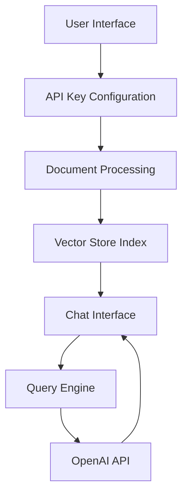

# Talk to PDF 🤖📑

[](https://talk-to-pdf.streamlit.app/)

## Overview

Talk to PDF is an innovative web application that enables natural language interaction with PDF documents through an AI-powered interface. Using OpenAI's language models and LlamaIndex for document processing, the application creates a seamless question-answering system that allows users to extract information from PDFs through natural conversation rather than manual searching.

### Key Features

- 🔑 Secure API key management
- 📄 Support for multiple PDF document uploads
- 🔍 Advanced document indexing and vector storage
- 💬 Context-aware conversation system
- ⚡ Real-time response streaming
- 🎛️ Configurable AI model parameters
- 🎯 Precise information extraction

## Architecture

The application follows a modular three-tier architecture:



### Component Structure

```
talk_to_pdf/
├── 0_🔌API_KEY.py          # API configuration entry point
├── functions.py            # Shared utility functions
└── pages/
    ├── 1_📑UPLOAD_PDF.py   # Document processing
    └── 2_💬CHAT_WITH_PDF.py # Chat interface
```

## Technical Implementation

### 1. Document Processing

```python
def load_document(uploaded_files):
    temp_dir = tempfile.TemporaryDirectory()
    for file in uploaded_files:
        temp_filepath = os.path.join(temp_dir.name, file.name)
        with open(temp_filepath, "wb") as f:
            f.write(file.getvalue())
    reader = SimpleDirectoryReader(input_dir=temp_dir.name)
    docs = reader.load_data()
    return docs
```

### 2. Context-Aware Chat Engine

```python
custom_prompt = PromptTemplate("""
Given a conversation (between Human and Assistant) and a follow up message from Human, \
rewrite the message to be a standalone question that captures all relevant context \
from the conversation.

<Chat History> 
{chat_history}

<Follow Up Message>
{question}

<Standalone question>
""")

chat_engine = CondenseQuestionChatEngine.from_defaults(
    query_engine=query_engine, 
    condense_question_prompt=custom_prompt,
    chat_history=custom_chat_history
)
```

### 3. Real-Time Response Streaming

```python
def conversational_chat(query):
    streaming_response = chat_engine.stream_chat(query)
    response_tokens = []
    for token in streaming_response.response_gen:
        response_tokens.append(token)
    return ''.join(response_tokens)
```

## Technology Stack

### Core Technologies

| Technology | Version | Purpose |
|------------|---------|----------|
| Python | 3.11 | Primary programming language |
| Streamlit | 1.38.0 | Web application framework |
| OpenAI | 1.43.0 | Language models and embeddings |
| LlamaIndex | 0.11.3 | Document processing and indexing |
| PyPDF | 4.3.1 | PDF parsing and text extraction |

### UI Extensions

- streamlit-chat (v0.1.1)
- streamlit-extras (v0.4.7)
- streamlit-faker (v0.0.3)
- markdownlit (v0.0.7)

## Features and Benefits

### Enhanced Document Analysis

- Instant natural language querying
- Context-aware response generation
- Efficient document indexing
- Quick information retrieval

### User Experience

- Progressive interface disclosure
- Clear visual feedback
- Intuitive chat interaction
- Customizable AI parameters

### Technical Advantages

- Scalable architecture
- Efficient memory management
- Secure document processing
- Modular component design

## State Management

```python
# Session state initialization
if 'history' not in st.session_state:
    st.session_state['history'] = []
if 'generated' not in st.session_state:
    st.session_state['generated'] = ["Hello! Ask me anything about the uploaded document 🤗"]
if 'past' not in st.session_state:
    st.session_state['past'] = ["Hey! 👋"]
```

## Installation and Setup

1. Clone the repository
2. Install dependencies:
   ```bash
   pip install -r requirements.txt
   ```
3. Configure environment:
   - Set up OpenAI API key
   - Ensure Python 3.11+ is installed

## Usage

1. Launch the application:
   ```bash
   streamlit run 0_🔌API_KEY.py
   ```
2. Enter your OpenAI API key
3. Upload PDF document(s)
4. Start asking questions about the content

## Development

### Environment Setup

```json
{
  "name": "Python 3",
  "image": "mcr.microsoft.com/devcontainers/python:1-3.11-bullseye",
  "forwardPorts": [8501]
}
```

### Running Tests

```bash
# TODO: Add testing framework and instructions
```

## License

This project is licensed under the MIT License - see the [LICENSE](LICENSE) file for details.

## Contact

- Author: [Kaushal](https://twitter.com/holy_kau)
- LinkedIn: [Kaushal Powar](https://www.linkedin.com/in/kaushal-powar-a52b1a159/)
- Project Link: [Talk to PDF](https://github.com/yourusername/talk-to-pdf)

---

Made with ❤️ by Kaushal | [Support my work](https://www.buymeacoffee.com/kaushal.ai)