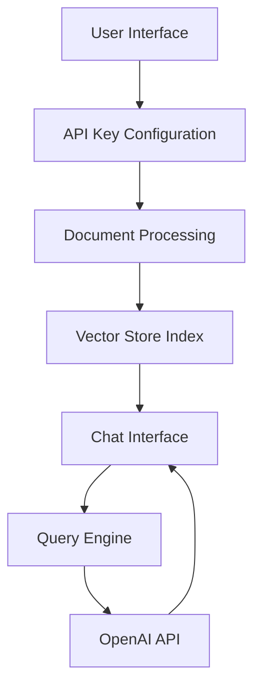

# Talk to PDF 🤖📑

[](https://talk-to-pdf.streamlit.app/)
[](https://www.python.org/downloads/)
[](https://choosealicense.com/licenses/mit/)
[](https://platform.openai.com/)

> An AI-powered application that enables natural language interaction with PDF documents through an intuitive chat interface.

## 🚀 Quick Start

1. Clone the repository
```bash
git clone https://github.com/yourusername/talk-to-pdf.git
cd talk-to-pdf
```

2. Install dependencies
```bash
pip install -r requirements.txt
```

3. Run the application
```bash
streamlit run 0_🔌API_KEY.py
```

## 🎯 Features

- 📝 Natural language interaction with PDF documents
- 🤖 Powered by OpenAI's GPT models
- 📊 Efficient document indexing using LlamaIndex
- 💬 Context-aware conversation system
- 🔄 Real-time response streaming
- 🎛️ Customizable model parameters

## 🏗️ Architecture

The application follows a modern, three-tier architecture:

1. **Presentation Layer**: Streamlit-based user interface
2. **Processing Layer**: Document indexing and query processing
3. **Integration Layer**: OpenAI API integration and vector storage

### Component Overview



## 💻 Technical Stack

### Core Technologies

- **Python** (3.11): Primary development language
- **Streamlit** (1.38.0): Web application framework
- **OpenAI** (1.43.0): Language model integration
- **LlamaIndex** (0.11.3): Document processing and indexing
- **PyPDF** (4.3.1): PDF parsing and text extraction

### Key Components

#### 1. API Configuration Module (`0_🔌API_KEY.py`)
```python
def handle_api_key():
    """Secure API key management with validation"""
    api_key = st.text_input("Enter your OpenAI API key", type="password")
    st.session_state['api_key'] = api_key
    return bool(api_key)
```

#### 2. Document Processing Engine (`pages/1_📑UPLOAD_PDF.py`)
```python
def process_document(uploaded_files):
    """Efficient document processing pipeline"""
    with tempfile.TemporaryDirectory() as temp_dir:
        docs = load_and_index_documents(uploaded_files, temp_dir)
        return create_query_engine(docs)
```

#### 3. Chat Interface System (`pages/2_💬CHAT_WITH_PDF.py`)
```python
def handle_conversation(query: str) -> str:
    """Context-aware conversation management"""
    streaming_response = chat_engine.stream_chat(query)
    return ''.join(token for token in streaming_response.response_gen)
```

## 🛠️ Implementation Details

### Document Processing Pipeline

1. **File Upload**
   - Secure file handling
   - Format validation
   - Temporary storage management

2. **Content Indexing**
   - Text extraction
   - Vector embedding generation
   - Index creation

3. **Query Processing**
   - Context integration
   - Question reformulation
   - Response streaming

### State Management

```python
# Session state initialization
st.session_state.setdefault('history', [])
st.session_state.setdefault('generated', ["Hello! Ask me anything about the uploaded document 🤗"])
st.session_state.setdefault('past', ["Hey! 👋"])
```

## 🔧 Configuration

### Model Settings

```python
# Available models and parameters
MODELS = {
    "gpt-3.5-turbo": {"max_tokens": 4096, "default_temp": 0.7},
    "gpt-4": {"max_tokens": 8192, "default_temp": 0.5}
}

# Temperature range
TEMP_RANGE = (0.1, 1.0)
```

## 🚦 Error Handling

The application implements comprehensive error handling:

- API key validation
- File upload verification
- Processing status monitoring
- Stream error management

## 🔍 Troubleshooting

Common issues and solutions:

1. **API Key Issues**
   - Verify key format
   - Check account status
   - Ensure proper environment setup

2. **PDF Processing Errors**
   - Confirm file format
   - Check file permissions
   - Verify file isn't corrupted

3. **Performance Issues**
   - Optimize document size
   - Adjust model parameters
   - Check system resources

## 🤝 Contributing

1. Fork the repository
2. Create your feature branch (`git checkout -b feature/AmazingFeature`)
3. Commit your changes (`git commit -m 'Add some AmazingFeature'`)
4. Push to the branch (`git push origin feature/AmazingFeature`)
5. Open a Pull Request

## 📝 License

This project is licensed under the MIT License - see the [LICENSE](LICENSE) file for details.

## 📬 Contact

Author: [Kaushal](https://twitter.com/holy_kau)

Project Link: [https://github.com/yourusername/talk-to-pdf](https://github.com/yourusername/talk-to-pdf)

---

Made with ❤️ by Kaushal | [Twitter](https://twitter.com/holy_kau) | [LinkedIn](https://www.linkedin.com/in/kaushal-powar-a52b1a159/)