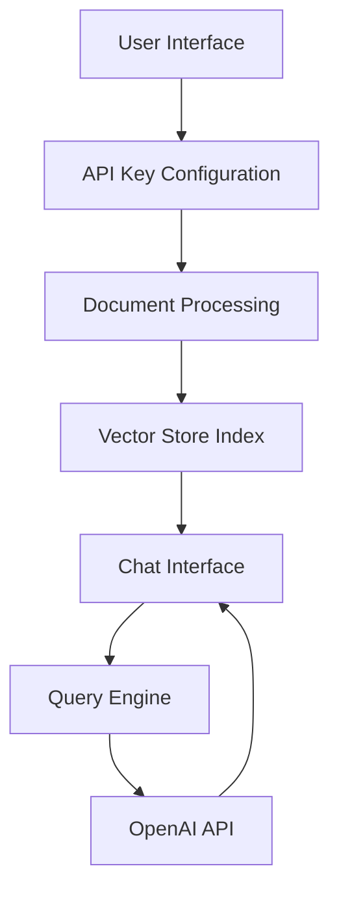

# Talk to PDF 🤖📑

[](https://talk-to-pdf.streamlit.app/)
[](https://www.python.org/downloads/release/python-311/)
[](https://choosealicense.com/licenses/mit/)
[](https://openai.com/blog/openai-api)

An innovative AI-powered application that enables natural language interaction with PDF documents. Using cutting-edge technologies including OpenAI's language models and LlamaIndex, Talk to PDF creates a seamless question-answering system for PDF content.

## 🚀 Quick Start

1. **Install Dependencies**
   ```bash
   pip install -r requirements.txt
   ```

2. **Configure OpenAI API**
   - Get your API key from [OpenAI Platform](https://platform.openai.com/account/api-keys)
   - Enter it in the application when prompted

3. **Run the Application**
   ```bash
   streamlit run 0_🔌API_KEY.py
   ```

4. **Upload PDF & Start Chatting**
   - Upload your PDF document
   - Ask questions in natural language
   - Get instant, context-aware responses

## 🏗️ Architecture

The application follows a modern, three-tier architecture:

1. **Presentation Layer** (Streamlit UI)
2. **Processing Layer** (Document Indexing & Query Processing)
3. **Integration Layer** (OpenAI API & Vector Storage)



### Directory Structure
```
talk_to_pdf/
├── 0_🔌API_KEY.py          # API configuration entry point
├── functions.py            # Shared utility functions
└── pages/
    ├── 1_📑UPLOAD_PDF.py   # Document processing
    └── 2_💬CHAT_WITH_PDF.py # Chat interface
```

## 💡 Key Features

### 1. Intelligent PDF Processing
- Advanced document indexing using LlamaIndex
- Efficient vector storage for quick retrieval
- Support for multiple PDF documents
- Secure temporary file handling

### 2. Context-Aware Chat Interface
- Natural language question answering
- Conversation history management
- Real-time response streaming
- Custom prompt templates for accurate responses

### 3. Flexible Configuration
- Multiple GPT model options (GPT-3.5-turbo, GPT-4)
- Adjustable temperature settings
- Customizable chat behavior
- Session state persistence

## 🛠️ Technical Stack

### Core Technologies
- **Python** (3.11): Primary development language
- **Streamlit** (1.38.0): Web application framework
- **OpenAI** (1.43.0): Language model integration
- **LlamaIndex** (0.11.3): Document processing engine

### Key Dependencies
```python
streamlit==1.38.0
openai==1.43.0
llama-index==0.11.3
pypdf==4.3.1
```

## 📚 Implementation Details

### API Configuration
```python
def handle_api_key():
    api_key = st.text_input("Enter your OpenAI API key", type="password")
    st.session_state['api_key'] = api_key
    if api_key:
        openai.api_key = api_key
        return True
    return False
```

### Document Processing
```python
def load_document(uploaded_files):
    with tempfile.TemporaryDirectory() as temp_dir:
        for file in uploaded_files:
            temp_filepath = os.path.join(temp_dir, file.name)
            with open(temp_filepath, "wb") as f:
                f.write(file.getvalue())
        reader = SimpleDirectoryReader(input_dir=temp_dir)
        return reader.load_data()
```

### Chat Engine
```python
def create_chat_engine(query_engine, custom_prompt, chat_history):
    return CondenseQuestionChatEngine.from_defaults(
        query_engine=query_engine,
        condense_question_prompt=custom_prompt,
        chat_history=chat_history
    )
```

## 🔄 State Management

The application uses Streamlit's session state for persistent data:

```python
# Initialize session state
if 'history' not in st.session_state:
    st.session_state['history'] = []
if 'generated' not in st.session_state:
    st.session_state['generated'] = ["Hello! Ask me anything about the uploaded document 🤗"]
if 'past' not in st.session_state:
    st.session_state['past'] = ["Hey! 👋"]
```

## 🎯 Benefits

1. **Enhanced Efficiency**
   - Quick information extraction
   - Natural language interaction
   - Context-aware responses

2. **User Experience**
   - Intuitive interface
   - Real-time feedback
   - Customizable settings

3. **Technical Advantages**
   - Scalable architecture
   - Efficient memory management
   - Secure document handling

## 🤝 Contributing

1. Fork the repository
2. Create your feature branch (`git checkout -b feature/AmazingFeature`)
3. Commit your changes (`git commit -m 'Add some AmazingFeature'`)
4. Push to the branch (`git push origin feature/AmazingFeature`)
5. Open a Pull Request

## 📝 License

This project is licensed under the MIT License - see the [LICENSE](LICENSE) file for details.

## 📬 Contact

Kaushal - [@holy_kau](https://twitter.com/holy_kau) - [LinkedIn](https://www.linkedin.com/in/kaushal-powar-a52b1a159/)

Project Link: [https://github.com/yourusername/talk-to-pdf](https://github.com/yourusername/talk-to-pdf)

---

Made with ❤️ by [Kaushal](https://twitter.com/holy_kau)